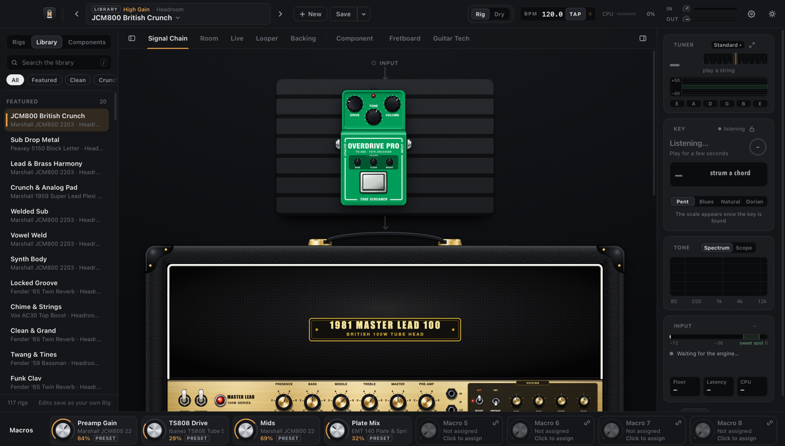
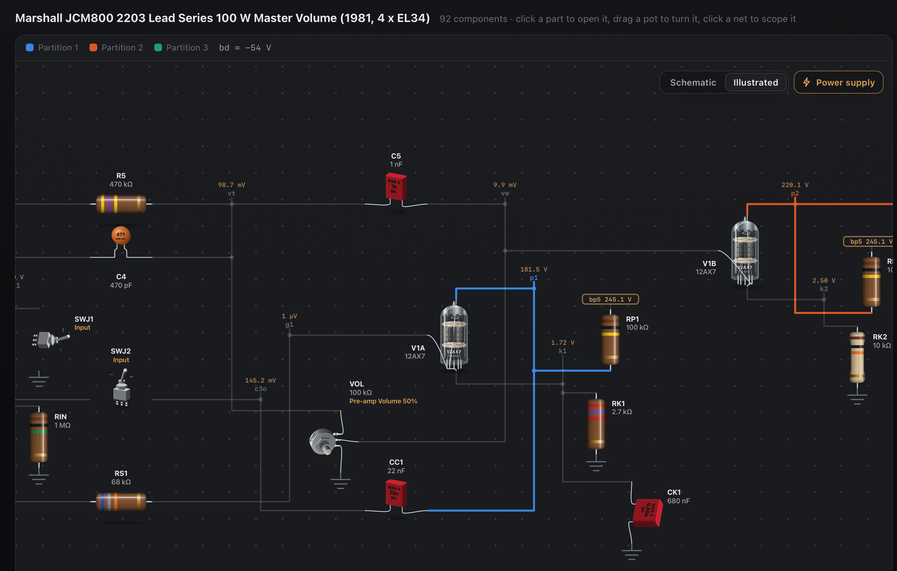
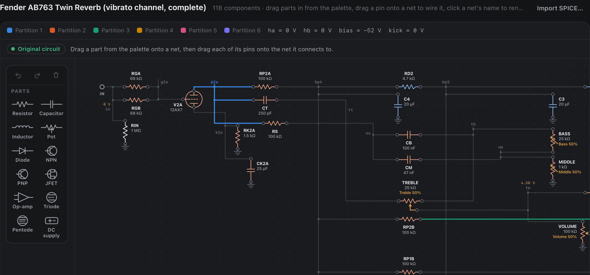
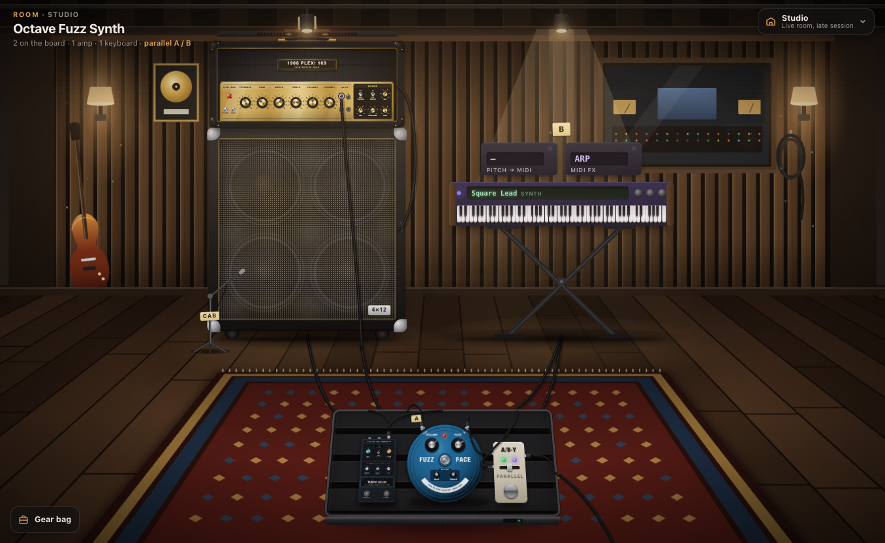
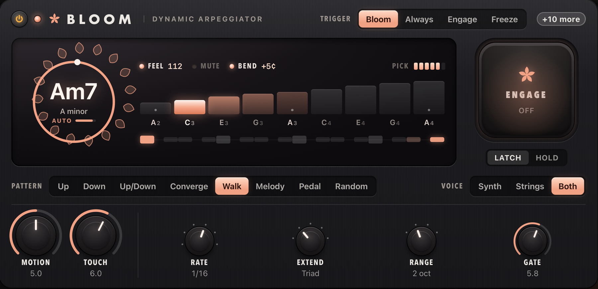
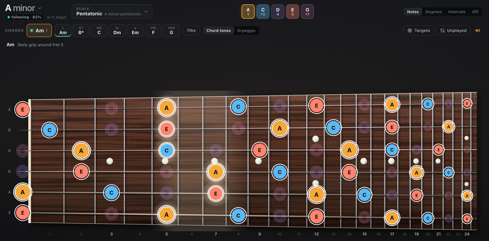
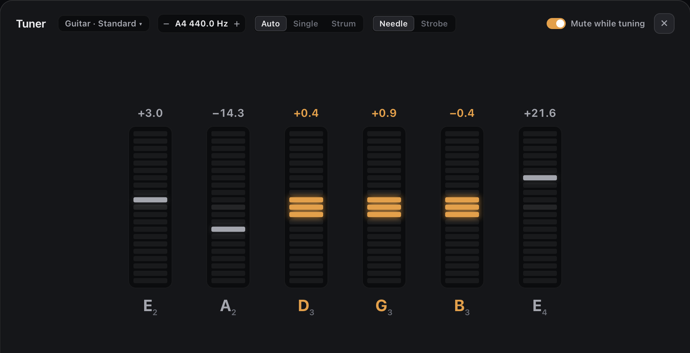
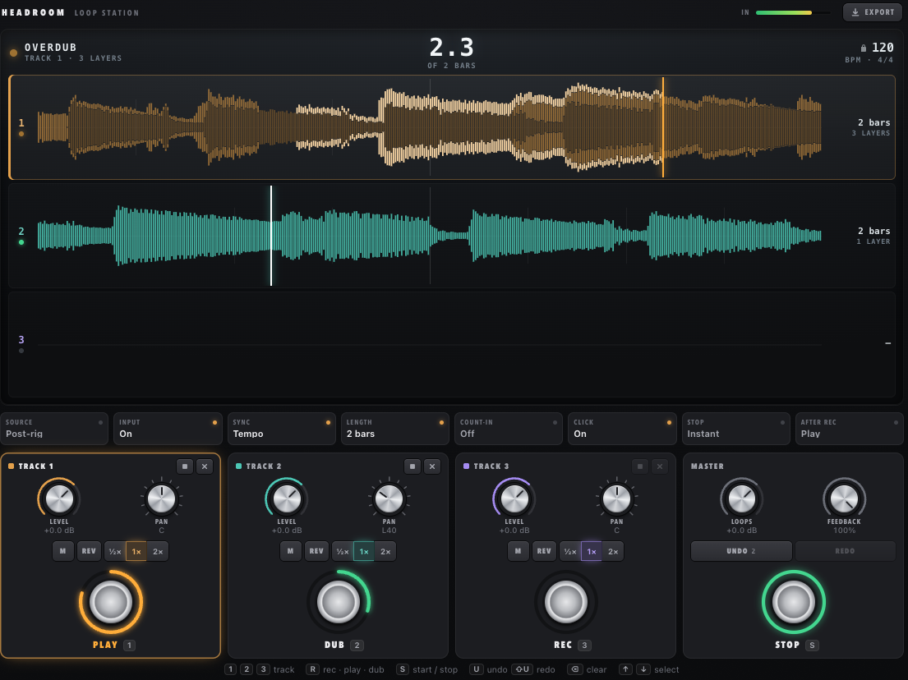

<p align="center">
  <picture>
    <source media="(prefers-color-scheme: dark)" srcset="app/resources/brand/headroom-logo-dark.svg" />
    
  </picture>
</p>

<h2 align="center">Real amps, solved part by part while you play.<br />68 amps, pedals and studio processors you can open, re-cap and rewire, and a synth you play from your guitar's own pickups.</h2>

<p align="center">
  Plug in and play a <b>'65 Twin Reverb</b>, a <b>JCM800</b> or a <b>Dual Rectifier</b>. Headroom runs each one from its schematic, tubes, transformer and power supply included, and checks it against <b>SPICE</b>. Strum a chord and Headroom also hears <b>every note</b>, so a pad, an organ or an arpeggio plays along through an ordinary guitar cable.
</p>

<p align="center">
  <a href="https://github.com/braedonsaunders/headroom/releases/latest"></a>
  
  
  
  
  <a href="LICENSE"></a>
  <a href="#what-does-headroom-connect-to"></a>
</p>

<p align="center">
  <a href="#why-headroom-exists">Why Headroom</a> ·
  <a href="#down-to-the-capacitor">Down to the capacitor</a> ·
  <a href="#whats-on-the-board">What's on the board</a> ·
  <a href="#play-both-parts">Guitar to MIDI</a> ·
  <a href="#bring-your-own-sound">Your own sound</a> ·
  <a href="#practice-and-play-live">Practice &amp; live</a> ·
  <a href="#under-the-hood">Under the hood</a> ·
  <a href="#get-playing-in-five-minutes">Get playing</a> ·
  <a href="#questions-youre-about-to-ask">FAQ</a>
</p>

<p align="center">
  
</p>

## Why Headroom exists

Most amp sims give you a snapshot. A capture records one amp at one group of settings. A conventional model is tuned until it sounds like the amp at the settings someone tested. Both can sound great, but neither can tell you what happens when you roll back the volume on a Plexi with a different bright cap. If you want synth or organ under your guitar part, that usually means a hex pickup, a converter box and a second rig. The tuner, looper and practice player are often separate tools too.

Headroom takes a different approach. **The schematic is the model.** Every one of its 68 circuit units runs from a netlist of the real circuit: each resistor, capacitor, diode, transistor, op-amp, tube and transformer, and the power supply feeding them. Headroom solves it at audio rate while you play. Turn a knob and it moves a real potentiometer in that circuit. Swap a part and you hear what the part does.

When you dig in, **the amp responds the way the circuit does.** The supply sags, the bias shifts, the coupling caps block and recover, and the speaker pushes back on the output transformer. When you strum a chord, Headroom also **hears the individual notes from your regular pickups** and can play them on a synth, keys or organ beside the amp.

| What you get | What you stop putting up with |
| :--- | :--- |
| **The real circuit, every setting.** Every knob position, every mod and every playing dynamic comes from the same solved circuit, from bedroom volume to dimed. | A capture that only sounds right at the settings it was recorded at. |
| **Mods you can hear before you solder.** Change the bright cap, swap a 12AX7 for a 12AT7 or replace the op-amp in a drive pedal, then replay the same riff. | Guessing from forum posts, or buying parts to find out. |
| **Synth from the same six strings.** Polyphonic guitar-to-MIDI from standard pickups, running in the same rig as your amp. | A hex pickup, a converter box, and a second rig to keep in sync. |
| **One app for the whole session.** Strum tuner, key detection, fretboard, backing tracks with time-stretch, a three-track looper and a stage view. | A tuner pedal, a looper pedal, a practice app and a DAW open just to play along. |
| **Your captures, your cabinets.** Neural Amp Modeler captures and your own impulse responses sit in the same chain as the circuit models. | Choosing between a capture library and a modelling library. |

---

## Down to the capacitor

**The schematic you see is the circuit you hear.** Turn down the preamp on the JCM800 2203. On the original amp, a small capacitor across the volume pot lets treble through as you roll back the gain. Headroom models that path, right down to the **1 nF bright cap marked C5**. If the low-gain sound is too bright for your guitar, open **Customize**, try a smaller cap and replay the same dry riff. You hear what that one part does before you save the mod.

<p align="center">
  
  <br /><sub><b>The JCM800 preamp, illustrated.</b> Click a part to inspect its value, or click a connection to scope the test signal at that point.</sub>
</p>

The same approach runs through the whole board:

* **Re-cap, re-tube, re-bias.** Every part value is editable. Device swaps cover the parts that matter: tubes (12AX7, 12AT7, 12AU7 and more), op-amps (TL072, NE5532, LM308 and more) and diodes (1N914, 1N34A germanium, LEDs). Save the result as one of **My Components** and use it in any rig.
* **Rewire it.** Edit mode turns the schematic into a circuit editor. Drag in resistors, caps, inductors, pots, diodes, transistors, JFETs, op-amps, triodes, pentodes or a DC supply, wire their pins onto nets, and undo anything. Your edits are stored as a small diff over the factory circuit, so they survive model updates. **Import SPICE** brings in a netlist from elsewhere.
* **Scope any point.** Click any net to see its waveform and DC operating point, up to five at a time. Watch V1's plate clip, or see where the TS808's diodes start to round the peaks.
* **Hear the playing dynamics.** Power-supply sag, grid-current blocking, output-transformer limits and speaker impedance all come from the circuit. Drop the **Plexi onto a Variac** and the same 1959 circuit runs on about 90 VAC mains, for an earlier, softer, browner breakup.
* **Stack them the way real gear stacks.** Turn up a TS808 in front of the JCM800 and you drive the amp's first tube harder. Pedal drive, pedal level and amp gain give you three different ways to shape the attack of the same chord.

<table>
  <tr>
    <td width="50%" valign="top">
      <a href=".github/assets/headroom-circuit-editor.png"></a>
      <p align="center"><sub><b>Circuit editor:</b> the complete Twin Reverb, 118 parts, with a palette to add your own</sub></p>
    </td>
    <td width="50%" valign="top">
      <a href=".github/assets/headroom-room.png"></a>
      <p align="center"><sub><b>Room view:</b> your rig laid out as real gear, with a keyboard for the synth lane</sub></p>
    </td>
  </tr>
</table>

---

## What's on the board

Every unit below runs as a full circuit. Each passes a gate against **ngspice** running the same netlist before it ships, along with level, DC and aliasing checks.

| Category | Circuit models |
| :--- | :--- |
| **Amps** (25) | Fender 5E3 Tweed Deluxe, 5F6-A Bassman, AB763 Deluxe Reverb and Twin Reverb · Marshall 1959 Super Lead (and on a Variac), JMP 2203, JCM800 2203, 1959RR · Vox AC15 and AC30 Top Boost · Hiwatt DR103 · Orange OR120 · Supro 1624T · Soldano SLO-100 and SLO-100 MK II · Peavey 5150 · Mesa/Boogie Dual Rectifier and Rev C · Bogner Ecstasy 101B and Uberschall · Friedman BE-100 · Roland JC-120 · Ampeg SVT · EAE Surveyor |
| **Drive, fuzz and boost** (19) | Tube Screamer TS808 and TS9DX · Transparent Charge-Pump Overdrive · British Blues-Breaker Overdrive · DS-1 · RAT · Big Muff Pi · Fuzz Face (silicon, germanium and vintage germanium) · Rangemaster · MT-2 Metal Zone · HM-2 · JH-1 Jackhammer · SansAmp GT2 · Butler Tube Driver · Harmonic Percolator · MXR Micro Amp · OC-2 Octave |
| **Modulation, filter, delay and reverb** (16) | Phase 90 · Small Stone · Mu-Tron Bi-Phase · Uni-Vibe · Electric Mistress · CE-1 · Dimension D · Deluxe Memory Man · RE-201 Space Echo · Mu-Tron III · Cry Baby (two versions) · V846 wah · optical tremolo · Fender 6G15 reverb unit · Leslie 122 |
| **Studio dynamics and EQ** (8) | Dyna Comp · 1176LN · LA-2A · Fairchild 670 · dbx 160 · SSL 4000 E channel dynamics · SSL 4000 G bus compressor · SSL 4000 E channel EQ |

Around them sit the rest of the rack: cabinets and mics, reverbs, utilities, the MIDI and instrument units, and any Audio Unit or VST3 plugin you own (on macOS).

---

## Play both parts

**Strum a chord and play the whole pad.** Headroom's **Pitch → MIDI** unit listens to the notes coming from your guitar's regular pickups and turns them into MIDI as you play. A parallel split keeps the amp on one lane while an instrument plays on the other, and the two meet at a mix you can put on a macro.

Open **Crunch & Analog Pad**. Pick a short chord and you hear the Plexi crunch right away. Let it ring and the pad swells in underneath. **Guitar ↔ Pad** sets the balance and **Pad Swell** sets how quickly the synth arrives. You can play the rhythm and the keys part in one take.

* **Tracking you can trust.** The default neural tracker streams in 5.3 ms frames with no look-ahead. On a polyphonic test set played on a guitar it never trained on, it finds **87 % of notes (F1 0.873)** with a **median delay of 11.8 ms**. It catches legato notes and notes struck inside ringing chords, not only pick attacks.
* **Instruments in the box.** FM keys and bells, a drawbar organ, a virtual-analog synth and a full **Poly Synth**. On macOS, the 128-sound General MIDI bank adds piano, horns, strings and choir, and any installed Audio Unit instrument plays from the guitar too.
* **MIDI FX.** Octave, transpose, harmony, scale, hold and an arpeggiator.
* **Bloom.** A guitar-played arpeggiator. It reads the chord you pick, completes it in key, and plays the figure on its own clock. Pick harder for louder notes, mute the strings to stop it, bend and it follows. The same riff always plays the same arpeggio.
* **Send it to your DAW.** On macOS, the **Headroom MIDI Out** port lets a DAW record or play along with what you play.

<table>
  <tr>
    <td width="50%" valign="top">
      <a href=".github/assets/headroom-bloom.png"></a>
      <p align="center"><sub><b>Bloom:</b> strum Am7 and it plays a keyed, voice-led arpeggio</sub></p>
    </td>
    <td width="50%" valign="top">
      <a href=".github/assets/headroom-fretboard.png"></a>
      <p align="center"><sub><b>Fretboard:</b> follows the key you play in, and lights up the notes as you play them</sub></p>
    </td>
  </tr>
</table>

---

## Bring your own sound

**A capture recalls an amp at the settings where it was recorded. A circuit model lets you change how the amp behaves.** Headroom plays both. Drop a favourite **Neural Amp Modeler** capture into a chain, drive it with a circuit-modelled fuzz, then load your own cabinet impulse response. Or open **Studio Cab Room** and blend mics on the cabinet while the part plays.

* **Neural Amp Modeler captures** play natively and are loudness-matched from their metadata. Captures marked as amp heads get a cabinet automatically.
* **Cabinets and rooms.** Pick a cabinet, drag mic A and mic B across the cap, cap edge and cone, pull a mic back, and add room. Import your own `.wav` impulse responses alongside the built-in ones. The stock cabinets and reverb spaces are synthesized by Headroom itself, so a fresh install needs no sample packs.
* **Your plugins as rack units (macOS).** Audio Unit and VST3 effects and instruments become cards you drag into the chain or a split lane. Their knobs are macro-assignable, and their state is saved in your rig.
* **117 factory rigs to start from.** Thirty-one **Showcase** rigs show off the guitar-plus-synth sounds, from **Jazz Organ & Rotor** to **Metal Orchestra**. The **Library** covers clean, crunch, high gain, bass, ambient and **Guitar + MIDI**. In **Artist Tones**, each rig lists the interviews and rig rundowns behind the sound.
* **Presets that keep their level.** Every library rig is levelled once by rendering real guitar performances, so switching rigs doesn't jump in volume. Nothing re-levels a rig behind your back after you change it.

---

## Practice and play live

The right-hand **Listen** pane follows whatever you play, and the centre tabs cover the rest of a practice session or a gig.

* **Tuner.** Single-string accuracy within 0.07 cents from B0 to C7. Strum all the open strings and the **polyphonic tuner** reads them at once. There are needle, strobe and per-string views, presets for guitar, bass, ukulele, mandolin, violin, cello and banjo, and the output mutes while you tune.
* **Key and chord.** Headroom works out the key from the notes you play and shows the chord and its function, so the **Fretboard** can light up the right scale, positions and chord tones.
* **Backing.** Load a song, drag across the waveform to loop a hard phrase, and slow it to 50 % without changing its pitch. You can also transpose it without changing its tempo. Add a count-in, or play along with a YouTube video instead.
* **Looper.** Three tracks with overdub layers, undo and redo, half and double speed, reverse, and tempo sync. Record after the rig, or record the dry guitar to re-amp it later.
* **Live view.** The rig name in huge type, big previous and next pads, setlists, scenes A to D and the eight macros, all readable from across the room. Keyboard keys double as footswitches.
* **Guitar Tech.** An AI assistant at a repair bench that answers gear questions and can build or change your rig. It uses your own key for OpenRouter, Anthropic, OpenAI or a local model, and asks before changing anything.

<table>
  <tr>
    <td width="50%" valign="top">
      <a href=".github/assets/headroom-tuner.png"></a>
      <p align="center"><sub><b>Strum tuner:</b> one strum, six readings, mute while tuning</sub></p>
    </td>
    <td width="50%" valign="top">
      <a href=".github/assets/headroom-looper.png"></a>
      <p align="center"><sub><b>Looper:</b> three tracks, layered overdubs, tempo sync and export</sub></p>
    </td>
  </tr>
</table>

---

## Under the hood

```
        your guitar  ──►  input  ──►  Listen: tuner · key · chord · tone       (reads the dry signal)
                            │
                            ▼
  ┌─────────────────────────────────── HEADROOM ENGINE ───────────────────────────────────┐
  │  Rig graph           Serial chain · parallel A/B splits · 8 macros · scenes A–D       │
  │  Circuit engine      Netlist → exact partitioner → per-group solver (DK · WDF · SS)   │
  │  Device library      Triode · pentode · BJT · JFET · op-amp · OTA · opto · BBD · CMOS │
  │  Supply & output     Rectifier · sag · output transformer · speaker load              │
  │  Pitch → MIDI        Causal neural tracker (5.3 ms frames) · mono YIN with bends      │
  │  Instruments         FM keys · drawbar organ · VA / poly synth · Bloom · MIDI FX      │
  │  Cab & capture       Partitioned convolution · mic placement · NAM · your IRs         │
  │  Practice            Backing tracks with time-stretch · 3-track looper · DI player    │
  └──────────────────────────────────────────┬────────────────────────────────────────────┘
                                             │  HTTP on 127.0.0.1 only
                                             ▼
                 Headroom UI: Signal Chain · Room · Live · Looper · Backing · Component · Fretboard · Guitar Tech
```

### 1. One engine for every circuit
* **Exact partitioning.** Wherever a circuit has a one-way boundary, such as an op-amp output driving a node that is only sensed, no current crosses it. Headroom finds every such cut automatically and solves each side on its own, so a full TS808 becomes four small problems instead of one nine-dimensional one, with no approximation.
* **The right solver for each part of the circuit.** Linear sections run as state space. Sections with one diode-like part run as wave digital filters, which stay stable while you sweep a wah or phaser. Everything else runs as a nodal DK solve with damped Newton iteration. Where two forms solve the same section, they agree to about a billionth of a volt.
* **Checked against SPICE.** Every model is rendered side by side with ngspice running the same netlist and the same device models, with frozen reference renders in the test suite. Because both solvers share the netlist, each unit is also checked for absolute level, DC bias at the op-amp inputs and node-by-node gain, so a miswired circuit can't pass by matching itself.
* **Aliasing gate.** Each unit is driven with test tones into hard clipping, and harmonics folded back into the audio band above the gate's threshold fail the test suite.

### 2. Tubes, supplies and speakers that behave like hardware
* **Tube laws from the datasheets.** Triodes use the Koren model. Pentodes model screen current, and the EL84 is fitted to the Philips datasheet. Grid current, cathode bypass caps and coupling-cap blocking all come out of the solve.
* **The whole amp, not just the preamp.** The complete amps include the rectifier and filter caps, the phase inverter, the push-pull power stage, the output transformer's winding capacitance and the speaker's impedance. That's why a dimed amp compresses and blooms, and why the Plexi on a Variac sounds different from the same circuit on full mains.
* **Accurate where you can hear it, fast where you can't.** Tube stages stop iterating at a tolerance far below what the ear can hear, and the rest of the circuit uses a stricter one. Ahead-of-time generated solver kernels and profile-guided builds keep the cost down without touching the result: the shipped optimisations are checked to null against the reference renders.

### 3. Guitar-to-MIDI measured against notes that are known to be right
* **A benchmark with exact answers.** A magnetic pickup's output is the sum of its strings, so the **GuitarMix** benchmark builds polyphonic guitar DI by summing real recordings of single notes. Every note's pitch, start and end is exact by construction. The test guitar never appears in training.
* **Why it's early, not late.** Hand-annotated datasets run 10 to 25 ms late, and models trained on them learn to fire late. Training on exact labels, with a decoder that also fires on sustained pitches, is what brings the median delay down to 11.8 ms.

---

## Get playing in five minutes

| Platform | Download | Details |
| :--- | :--- | :--- |
| **macOS 13+** | [`Headroom-<version>-macOS-universal.dmg`](https://github.com/braedonsaunders/headroom/releases/latest) | Universal app for Apple Silicon and Intel, with Core Audio. *(Beta builds are ad-hoc signed and not notarized. If macOS blocks the app, use System Settings › Privacy & Security › Open Anyway.)* |
| **Windows (x64)** | [`Headroom-<version>-win64.zip`](https://github.com/braedonsaunders/headroom/releases/latest) | Portable app with native **ASIO** and **WASAPI**. Needs the WebView2 Runtime and the Microsoft Visual C++ x64 Redistributable. *(Beta builds are unsigned.)* |

1. **Install.** On a Mac, open the disk image and drag Headroom into Applications. On Windows, extract the whole ZIP and keep `Headroom.exe` next to its `app` folder.
2. **Connect your guitar.** In **Settings → Audio**, choose **Live input**, your interface and the channel your guitar is plugged into. On Windows, choose your interface's ASIO driver, or use WASAPI. Turn **Monitor** on.
3. **Set your level.** Play hard and adjust the **IN** knob until your peaks land in the green sweet spot on the **Input** card.
4. **Open JCM800 British Crunch.** Play a chord softly, then dig in. Turn up **TS808 Drive** and listen to the attack change. Click **Save as my rig** when you want to keep it.
5. **Then open Crunch & Analog Pad** and let a chord ring.

No guitar nearby? Import a dry guitar recording into the DI player. It plays into the rig like a live guitar, so you can audition rigs and mods with the same performance each time.

**Building from source and the engine docs:** [**Build guide**](app/README.md#build) · [**Circuit engine**](app/docs/CIRCUIT_ENGINE.md) · [**Engine API**](app/docs/ENGINE_API.md) · [**Bloom**](app/docs/BLOOM.md) · [**Platform notes**](app/docs/PORTING.md)

---

## Things to know first

- **What Headroom is not:** It is not a capture of any particular amp you own, and it is not a DAW. Its models are built from published schematics, parts lists and datasheets, and they are measured against SPICE rather than against one specific unit of the hardware.
- **CPU:** Solving a whole amp is real work. On a Ryzen 9 9900X core, most of the circuit amps use roughly 40 to 80 % of one core, and pedals much less. The heaviest models, the **Peavey 5150** and the **Roland JC-120**, can still need more than one full core. The CPU meter in the top bar shows what your rig is using.
- **Latency:** Latency depends mostly on your interface and buffer size. In testing, a Universal Audio Volt 276 on Windows ASIO ran at 48 kHz with 128-sample buffers and **8.67 ms** driver-reported latency.
- **Platform differences:** The circuit models, factory rigs, built-in synths, Bloom, practice tools and looper run on both desktops. Audio Unit and VST3 plugin hosting, the General MIDI sound bank, Headroom MIDI Out and hardware MIDI input are **macOS only** for now.
- **Your data stays on your machine:** Rigs are plain files in your user folder. Headroom sends no analytics or usage data. See [What does Headroom connect to?](#what-does-headroom-connect-to)

---

## Questions you're about to ask

<details>
<summary><b>Do I need a MIDI pickup or a hex pickup?</b></summary>

No. Headroom tracks the notes from the same mono signal your amp hears, so any guitar with ordinary pickups works through any audio interface. A hex pickup is not used.
</details>

<details>
<summary><b>How close are the models to the real amps?</b></summary>

Accuracy is defined in two layers. **Solver accuracy:** each model is compared with ngspice running the same netlist and device models, and must match it before it ships. **Model accuracy:** each netlist is drawn from the published schematic and parts list for a specific revision of the circuit, and every source is recorded in the unit's netlist. Headroom does not claim to match one particular serial number of the hardware; real units vary with part tolerances and tube wear.
</details>

<details>
<summary><b>Can I use my Neural Amp Modeler captures and impulse responses?</b></summary>

Yes. Import `.nam` captures from the NAM unit or drop them into Headroom's **NAM Captures** folder, and import `.wav` impulse responses into the cabinet loader. Both sit in the same chain as the circuit models, so you can run a circuit-modelled fuzz into a capture, then into your own cabinet IR.
</details>

<details>
<summary><b>If I change a part, can I get the original back?</b></summary>

Yes. Your edits are stored as a small set of changes on top of the factory circuit, with undo and redo while you edit. Remove your edits and the factory circuit returns. Because only the changes are stored, a factory fix to the circuit still reaches every part you didn't touch.
</details>

<details>
<summary><b>Can I play the synth without the amp, or the amp without the synth?</b></summary>

Both. **MIDI** rigs play instruments alone from the guitar, such as **Concert Grand**, **Jazz Organ & Rotor** or **Late Night Tenor**. **Guitar + MIDI** rigs blend an amp lane with instruments. Any rig without a Pitch → MIDI unit plays your guitar straight through the amp.
</details>

<details>
<summary><b>Will it run on my computer?</b></summary>

Pedals and studio processors are light. Full circuit amps are the heavy part: on a current desktop CPU most amps fit within one core, but the 5150 and JC-120 can need more than that. If you hear crackles, raise the buffer size in **Settings → Audio** and watch the CPU meter.
</details>

<details id="what-does-headroom-connect-to">
<summary><b>What does Headroom connect to?</b></summary>

Headroom sends **no analytics, crash reports or usage telemetry**, and it doesn't check for updates in the background. The engine and the interface talk to each other on `127.0.0.1` only. Headroom goes online only when you use a feature that needs it:

1. **Guitar Tech:** messages go to the AI provider you configure (OpenRouter, Anthropic, OpenAI, Groq, or a local server such as Ollama or LM Studio). If you turn on web search, queries go to the search service you pick.
2. **Practice → YouTube:** the official YouTube player loads the video you open.

Your Guitar Tech API keys are kept in the macOS Keychain or the Windows Credential Manager, never in plain files.
</details>

---

## Where it stands today

Headroom 0.9 is a **public beta** for macOS and Windows. Every circuit unit passes its SPICE, level and aliasing gates in the test suite, and the Windows ASIO build has been tested end to end with real interface hardware.

| Capability | Status |
| :--- | :--- |
| **68 Circuit Models with Part Editing, Rewiring, Probes & SPICE Import** | **Beta** |
| **Polyphonic Guitar → MIDI, Instruments, MIDI FX & Bloom** | **Beta** |
| **Windows Desktop App with Native ASIO & WASAPI** | **New in 0.9** |
| **117 Factory Rigs (31 Showcase + Library with Artist Tones)** | Working |
| **Neural Amp Modeler Captures, Cab Room & Custom IRs** | Working |
| **Tuner, Key Detection, Fretboard, Backing Tracks & Looper** | Working |
| **Room View, Live View & Guitar Tech** | Working |
| **Audio Unit & VST3 Plugin Hosting, General MIDI Bank, MIDI Out** | Working (macOS) |

**Current boundaries:**
- The Peavey 5150 and Roland JC-120 models can need more than one CPU core.
- Plugin hosting, the General MIDI sound bank and MIDI in and out are macOS only.
- Beta builds are not code-signed for distribution: the Windows build is unsigned, and the macOS build is ad-hoc signed and not notarized.

---

## Credits

Headroom stands on published circuit research and open-source work. The circuit engine builds on the DK method of David Yeh and of Martin Holters and Udo Zölzer, wave digital filters from Alfred Fettweis, Kurt Werner and Jatin Chowdhury, and Norman Koren's tube models. Every schematic, datasheet and paper behind a model is listed in the [circuit engine sources](app/docs/CIRCUIT_ENGINE.md#11-sources-and-licences).

Headroom includes [NeuralAmpModelerCore](https://github.com/sdatkinson/NeuralAmpModelerCore) (MIT), Eigen (MPL-2.0), nlohmann/json (MIT), miniaudio (public domain / MIT-0), webview (MIT) and Signalsmith Stretch (MIT).

---

## Legal

Amplifier, pedal, studio-equipment, artist and song names in Headroom and its library are used only to describe a sound or the circuit a model was studied from. They are trademarks of their respective owners. Headroom is **not affiliated with, sponsored by or endorsed by** any of them. Library rigs inspired by a recording are original settings built from public sources, not captures of the original gear. ASIO is a registered trademark of Steinberg Media Technologies GmbH.

Headroom is free software: you can redistribute it and modify it under the terms of the [GNU General Public License v3.0](LICENSE).

[**GPL-3.0 License**](LICENSE) · [**Third-Party Notices**](app/packaging/THIRD_PARTY_NOTICES.txt)
